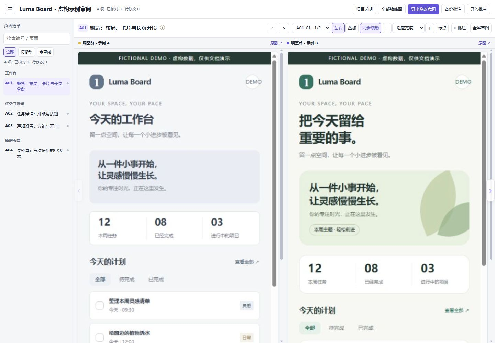
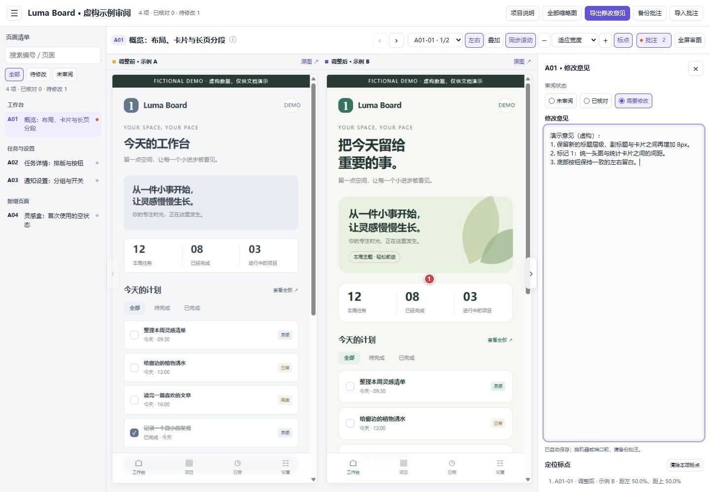
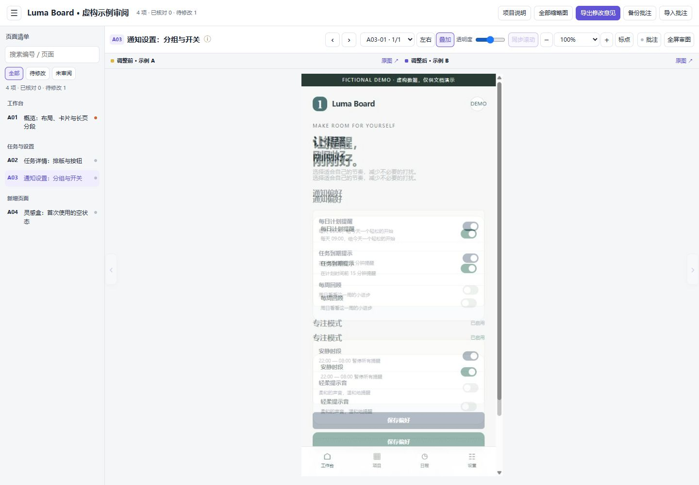
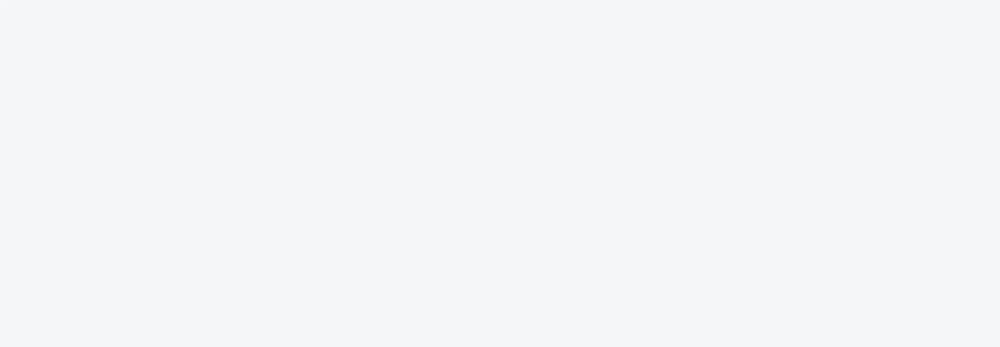
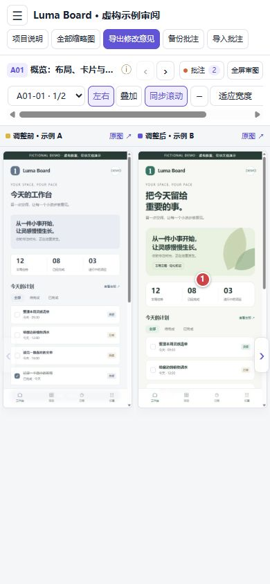
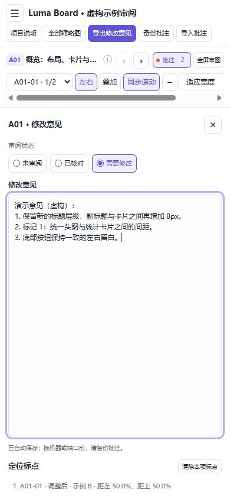

# 功能实拍指南

这里展示的是截图审阅工具的实际运行界面。**图中的 Luma Board、任务、数据和批注均为专门制作的虚构示例**，与任何实际开发项目无关。

## 1. 打开左右对照

左侧按编号选择页面，顶部选择滚动分段；截图占据剩余工作区，默认同步滚动。可以关闭同步、缩放、打开原图或全屏审图。

页面中的“FICTIONAL DEMO”是虚构应用自带的标识，审阅标题也标明“虚构示例”。两张图分别来自同一个演示页面的 `before` 和 `after` 样式。

## 2. 标点并填写意见

开启“标点”，点击截图定位问题。批注面板自动展开，和截图分别占位。三种状态直接展开；填写非空文字或放置标点后，状态立即成为“需要修改”。

工具栏中的“导出修改意见”生成 Markdown，“备份批注”生成可恢复的 JSON。图片中的演示意见仅用于说明这些功能。

## 3. 用透明叠加检查偏移

点击“叠加”，调整右侧透明度。两版的文字、边缘和组件位置一起显示，便于发现间距和位置变化。下面使用通知设置页面，在 50% 透明度下查看前后差异。

重叠的文字和开关是该模式显示出的真实位置差异，不是截图库的排版错误。叠加时使用同一个滚动区，缺少一侧截图的分段仍保留空缺。

## 4. 用全部缩略图查找页面

“全部缩略图”提供全流程目录。点击任意卡片返回该页面的分段对照，搜索和状态筛选同样适用。

此处只截取了概览页顶部的工具栏、目录和四张卡片，省去了下方空白区域。A01 有两段长页截图；A04 是新增页，左侧明确显示“未采集”。

## 5. 在窄屏中查看和批注

窄屏仍可查看左右截图；顶部操作栏可横向滚动。点击“批注”切换到独立意见视图，收起后返回截图，输入框不会覆盖图片。

<table>
<tr><th>手机审图</th><th>独立批注视图</th></tr>
<tr>
<td></td>
<td></td>
</tr>
</table>

## 来源与复现

- 虚构应用源码：[`examples/fictional-app.html`](../examples/fictional-app.html)。它不读取图片素材，不登录账号，不连接后台，页面只使用本文件中的 HTML/CSS 和固定演示文字。
- 演示页面由浏览器在逻辑 430×860 视口截图；截图工具实际输出 415×830 像素。JPEG 仅转换为 PNG 格式供生成器读取，没有重绘、合成或更改内容。
- 两版概览各采集顶部和页面末尾；底部分段偏移分别为 588px / 735px，已在本地演示清单中说明。任务详情、设置和新增空状态各采集一个分段。
- 按普通 manifest 格式生成独立审阅包，标题和 `project` 都使用虚构示例名称。在该审阅包中实际打开左右、批注、叠加、概览及手机视图，再拍摄这里的六张图片。
- 文档图片的尺寸、SHA-256、视口及虚构源码哈希记录于 [`images/provenance.json`](images/provenance.json)。只发布这里列出的图片，完整演示审阅包与临时截图留在本地。

复现时可用任意本机静态文件服务打开虚构 HTML，通过 `?screen=overview&revision=before` / `after` 切换版本；`screen` 还支持 `detail`、`settings` 和 `empty`。浏览器截图后，按[使用指南](USAGE.md)整理 PNG 与 manifest。

原有 `examples/create_demo.py` 仍提供不需要浏览器、只用 Python 标准库生成的抽象色块示例。文档说明图与技能安装包分开维护，安装包不含这些图片。
